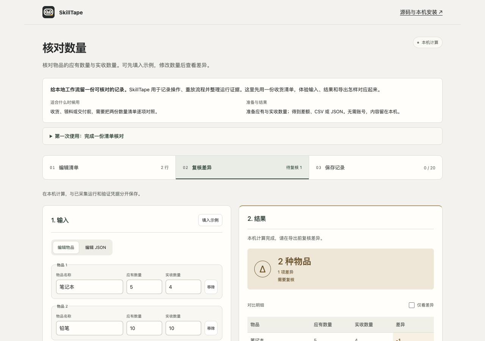

# SkillTape

[中文](README.md) · [Build](https://github.com/Chumaniac/skilltape/actions/workflows/ci.yml) · [License](LICENSE)

**Beta** · Turn a real local workflow into a reviewable Agent Skill you can replay and verify before you share it.

**[Try quantity reconciliation →](https://chumaniac.github.io/skilltape/)** · [CLI releases](https://github.com/Chumaniac/skilltape/releases/tag/v0.4.1) · [Chinese desktop release](https://github.com/Chumaniac/skilltape/releases/tag/user-2026.11.11-zh)

Start with the sample inventory, edit expected and received quantities, calculate the differences, then export the current CSV. The browser example handles the checklist locally. Command recording, replay and Receipt verification use the local CLI.

[](https://chumaniac.github.io/skilltape/)

## Run the source starter

Use the pinned [Rust toolchain](rust-toolchain.toml). Linux replay needs bubblewrap; macOS replay needs Xcode Command Line Tools. Build the CLI, then use the JSON exported by the browser as `request.json`. Both output directories must be new.

```sh
git clone https://github.com/Chumaniac/skilltape.git
cd skilltape
cargo build --locked -p skilltape-cli
./target/debug/skilltape starter new reconcile --request request.json --output inputs
./target/debug/skilltape starter run inputs --output run --yes
```

The source starter and the fixed v0.4.1 release have separate feature sets. The historical desktop release keeps its original files and checksums. Windows can prepare inputs and inspect records; replay and verification need a supported system sandbox.

## Continue locally

- [CLI installation and platform requirements](docs/guides/installation.md)
- [Local workflow quick start](docs/guides/quickstart.md)
- [Console and desktop builds](docs/build.md)
- [Stopped-workspace backup, verification and recovery](docs/workspace-backup.md)
- [Contributing](CONTRIBUTING.md) and [reporting security issues](SECURITY.md)

The local starter does not need an account, API key or environment variables. SHA-256 checks establish matching bytes; their result does not authenticate an author or certify arbitrary commands as safe.
