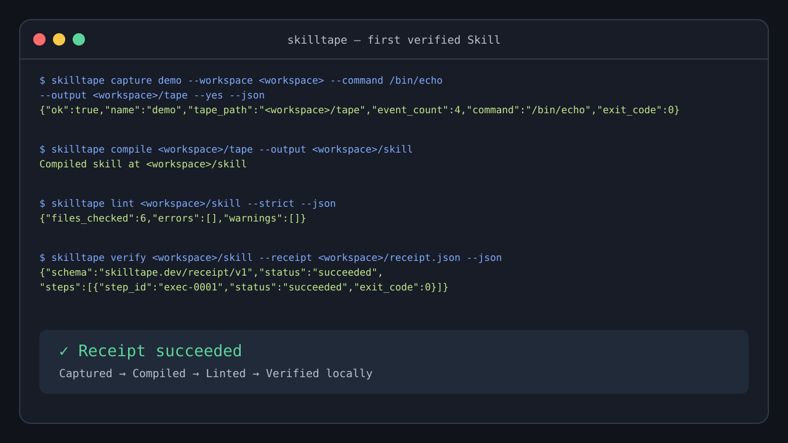

# SkillTape

> **Beta** — Turn a real local workflow into a reviewable Agent Skill you can replay and verify before you share it.

SkillTape captures a command you already run, turns it into a reviewable Skill,
and produces a Receipt that tells you whether the isolated replay succeeded.
It runs locally; the first result needs no account, API key, model provider, or
configuration file.



[Watch the 30-second terminal demo](docs/assets/quickstart-terminal.txt) · [Download v0.4.1](https://github.com/Chumaniac/skilltape/releases/tag/v0.4.1)

## Local starter tasks (main)

Source builds also support [resumable verification batches](docs/verification-batches.md): freeze a reviewed Skill and multiple input sets, run cases sequentially, explicitly retry failed cases with corrected snapshots, and review current/earlier Receipts in Console. Successful attempts remain unchanged; unknown outcomes do not automatically rerun. Preparation executes nothing, and this feature is not in the unchanged v0.4.1 download.

Create materials, review the inputs, then explicitly run one fixed local task:

```sh
skilltape starter new inventory --output inventory-task
skilltape starter run inventory-task --output inventory-run --yes
skilltape console --workspace inventory-run --open
```

Use `reconcile` instead of `inventory` to compare expected and received item
quantities. Both run Capture → Compile → Lint → Verify → Export and keep actual
results in `delivery/artifacts/report.json`. [Inputs and limits](docs/starter-inputs.md).
These commands are available in main builds; the v0.4.1 download below is unchanged.

## Version 0.4.1

Inspect a Skill before running it with `skilltape preflight SKILL --json`, or open the Console Permissions page. The bounded, read-only plan shows declared-policy denials without executing steps or producing a Receipt. [Preflight limits and usage](docs/policy-preflight.md).

The Receipt view names the recorded result, shows the next review action, and jumps to failed checks with keyboard focus. Execution-only Receipts remain explicit about missing checks.

[Download SkillTape v0.4.1](https://github.com/Chumaniac/skilltape/releases/tag/v0.4.1)
for Linux x86_64, Intel Mac, Apple Silicon Mac, or Windows x86_64. Packages
contain the native CLI, read-only Console API, and Console UI. The Release
workflow builds all four targets, publishes checksums and attestations, and
checks the packaged Console and Windows installer.

- Require exact output bytes with repeatable `verify --expect-sha256 PATH=SHA256`.
  A mismatch fails verification and leaves the delivery unpublished.
- Open real saved Receipts by filename, inspect explicit pass/fail outcomes,
  and filter checks needing attention in the Console.
- Retain required-file checks, saved-delivery review/comparison, literal
  Capture arguments, orderly cancellation, and bounded no-overwrite exports.

See [output digest checks](docs/guides/output-digests.md) and
[Receipt review](docs/guides/receipt-review.md) for complete usage examples.
Windows Replay/Verify still fail closed. Earlier
[v0.2.3 assets](https://github.com/Chumaniac/skilltape/releases/tag/v0.2.3)
and their dated verification evidence remain available.

## Get a verified Skill in five minutes

Install the fixed public v0.4.1 release without piping a download into a shell.
The installer below is fetched from commit
`9f6bec579258baa63234139af0fae650d9efdbd2`, and the release base URL stays
explicit.

```bash
SKILLTAPE_VERSION="0.4.1"
SKILLTAPE_RELEASE_BASE_URL="https://github.com/Chumaniac/skilltape/releases/download"
installer_path="$(mktemp)"
curl --fail --location --silent --show-error --output "$installer_path" \
  "https://raw.githubusercontent.com/Chumaniac/skilltape/9f6bec579258baa63234139af0fae650d9efdbd2/scripts/install.sh"
chmod +x "$installer_path"
export SKILLTAPE_VERSION SKILLTAPE_RELEASE_BASE_URL
bash "$installer_path"
export PATH="$HOME/.local/bin:$PATH"
skilltape --help
```

Then capture a harmless local command and get a verified result:

```bash
workspace="$(mktemp -d)"

skilltape capture demo --workspace "$workspace" --command /bin/echo --output "$workspace/tape" --yes --json
skilltape compile "$workspace/tape" --output "$workspace/skill"
skilltape lint "$workspace/skill" --strict --json
skilltape verify "$workspace/skill" --receipt "$workspace/receipt.json" --json
```

The final Receipt reports `"status":"succeeded"` when the isolated replay
completed successfully.

## What works today

On Linux, Replay and Verify require `bwrap`/Bubblewrap and an available user
namespace. On macOS, Replay and Verify use the system
`/usr/bin/sandbox-exec`. If that restricted executor is unavailable, Capture,
Compile, Lint, and Export remain usable while Replay and Verify fail closed.
Windows supports Capture, Compile, Lint, and Export; Replay and Verify
intentionally fail closed until an equivalent restricted executor is integrated.

The packaged Console supports previous/next navigation through Tapes and events,
keeping only the current page in memory. See the [Console guide](docs/guides/configuration.md#local-console-overrides)
for startup details. This improvement is included in v0.2.3.

v0.2.3 also bounds server-side Tape event reads to
16 MiB and 100,000 events while validating the complete stream. Capture merges
at most 10,000 events, charges allocated filesystem metadata against a 16 MiB
budget, and rejects oversized terminal event streams before merging. These are
retained-data budgets, not a process RSS guarantee. Complete Tapes are published
without replacing an existing destination; budget or finalization failures do
not publish a partial Tape. See the [resource limits](docs/guides/configuration.md#capture-and-tape-resource-limits).

For retained deliveries, run `skilltape console --workspace /path/to/saved-parent`
and choose **Delivery workbench**. This interface discovers actual
bundles directly and provides bounded file checks and review actions. It never
executes a workflow, edits files or declares business requirements accepted.
These features are included in the public v0.2.3 packages.

Version 0.3.0 also provides a saved-Receipt picker and an assertion review
with **All checks** and **Needs attention** filters. It reads the actual v1
`kind` field, shows explicit pass/fail labels, and keeps the run outcome visible
while filtering. See [review saved verification results](docs/guides/receipt-review.md)
for an operational example. This UI update requires v0.3.0 or the current source.

v0.2.3 also bounds Replay/Verify inputs to 10,000 entries, depth 64,
16 MiB per file, and 64 MiB in total. Hashing and staging reject detected changes
instead of reading a growing file without a limit. See the
[input integrity boundaries](docs/guides/domain-workflows.md) for platform and
concurrent-change limits. These checks are included in v0.2.3.

## Use SkillTape when

- You have a local command or workflow worth making repeatable and reviewable.
- You want to inspect the generated Skill before someone else runs it.
- You need a bounded Receipt from an isolated replay before sharing the result.

## It is not yet for

- Replacing a general-purpose agent runtime or model provider.
- Claiming isolated replay on Windows before its restricted executor exists.
- Treating unreviewed Tapes, workflows, or permissions as safe to run.

## Learn more

- [Expansion and deep optimization roadmap](docs/deep-optimization-roadmap.md) — concrete priorities, domain workflows, limits and release gates.
- [Stable export and Receipt association](docs/guides/export-evidence.md) — consistent bytes and explicitly unauthenticated evidence.
- [Verified local delivery](docs/guides/verified-delivery.md) — persistent artifacts, Receipt/file hashes, and an independently checked order-summary example.
- [Project overview](https://chumanic.com/projects/skilltape/) — Chinese introduction and current platform boundaries.
- [Domain workflow examples](docs/guides/domain-workflows.md) — source examples for code-review evidence, knowledge references, data-export integrity, and incident-review materials; no external execution or platform connection.
- [Quickstart](docs/guides/quickstart.md) — the same first verified result with troubleshooting.
- [Installation](docs/guides/installation.md) — platform, update, source-build, and release details.
- [Configuration](docs/guides/configuration.md) — optional release, installation, and Console settings.
- [Minimal Skill example](examples/minimal-skill/README.md) — a small valid package to inspect.
- [Security](SECURITY.md) — sandbox boundaries, redaction, and responsible disclosure.
- [Contributing](CONTRIBUTING.md) — development and contribution guidance.

### Require output files during Verify

With v0.2.3, use `skilltape verify ./skill --expect-file result.csv --expect-file summary.txt --json`. Each path is relative to the output root. Verify records each requirement in the Receipt and fails with exit code 3 if a required regular file is missing. A failed Verify does not publish a delivery directory. Unsafe paths fail before Replay; at most 64 paths of 1024 bytes each are accepted. This checks file existence, not business correctness or authenticated provenance. These requirements are available in the v0.2.3 CLI.

### Require exact output bytes in v0.3.0

Use v0.3.0 or the current source for `verify --expect-sha256 PATH=SHA256`. This option
checks the actual output against an independently supplied 64-digit SHA-256,
records a `file_hash` assertion in the Receipt, and leaves failed deliveries
unpublished. It shares the 64-requirement budget with `--expect-file` and retains
the existing sandbox. See the [output digest guide](docs/guides/output-digests.md)
for an example, limits and failure cases. This feature is not in the published
v0.2.3 archives.

### Recorded run conditions

Add `--context .skilltape/receipts/check.json.context` when saving a new
verification with `--receipt .skilltape/receipts/check.json`. Open `check` in
Console to review the input snapshot, Skill digest, executor/platform and limits,
then compare with another saved receipt ID. A context can also be written beside
a new delivery with an explicit path; the original three-member delivery format
remains unchanged.

Context v1 is an optional JSON sidecar, bound to the exact receipt bytes. It
reuses the existing bounded pre-run input digest, contains no raw inputs or
environment values, and cannot authenticate execution or freeze mutable inputs.
Old receipts show **Not recorded**; invalid or mismatched contexts are withheld.
The viewer reads at most 4 KiB of context and 8 MiB of receipt, with two bounded
inspections at a time. Existing output-file comparison remains available.
